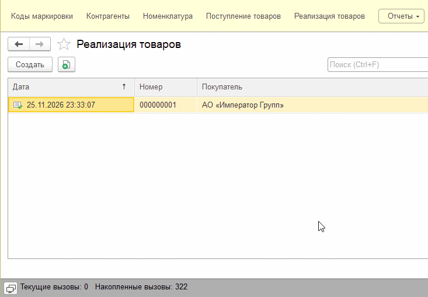

# Учёт маркированного товара и склада (1С:Предприятие 8.3)


-00A86B?style=flat-square)


Конфигурация на платформе **«1С:Предприятие 8.3»** (тонкий клиент, интерфейс «Такси»), моделирующая контур складского учёта и работу с кодами маркировки **GS1 DataMatrix (ИС МП «Честный ЗНАК»)** по логике подсистемы «1С:Управление торговлей 11».

Проект сделан для отработки проектирования структуры данных, пакетных запросов к виртуальным таблицам, работы с регистрами и транзакционной блокировки ошибок при проведении документов.

---

## Состав конфигурации

* **Справочники:**
  * `Номенклатура` — товары с признаком обязательной маркировки (`МаркируемыйТовар`, Булево) и артикулом.
  * `Контрагенты` — поставщики и покупатели с реквизитами (`ИНН`).
* **Регистры:**
  * `ОстаткиТоваров` *(Регистр накопления, вид: Остатки)* — количественный учёт товаров на складе в разрезе номенклатуры.
  * `КодыМаркировки` *(Независимый регистр сведений)* — пул активных кодов DataMatrix на балансе (`КодМаркировки`, `Номенклатура`, `ВНаличии`).
* **Документы и отчёты:**
  * `ПоступлениеТоваров` — приёмка товара на склад и постановка кодов DataMatrix на баланс.
  * `РеализацияТоваров` — пакетный контроль остатков, отгрузка и вывод кодов из оборота.
  * `ОстаткиИКодыМаркировки` *(Отчёт на СКД)* — сверка складских остатков с пулом активных марок.

---

## Реализованная логика (BSL и запросы)

### 1. Приёмка товара (`src/Documents/ПоступлениеТоваров.bsl`)
* **Проверка при проведении:** если в табличной части есть маркируемый товар без отсканированного кода DataMatrix, транзакция блокируется (`Отказ = Истина`).
* **Защита от дублей марок:** запись в независимый регистр сведений идёт через `МенеджерЗаписи`, дублирование кодов отсекается на уровне первичного ключа.
* **Движения:** формируется приход по регистру накопления `ОстаткиТоваров`.

### 2. Отгрузка и вывод из оборота (`src/Documents/РеализацияТоваров.bsl`)
* **Контроль остатков без запросов в цикле:** пакетный запрос к виртуальной таблице `ОстаткиТоваров.Остатки(&МоментВремени, ...)` с использованием `Граница(МоментВремени(), ВидГраницы.Исключая)`. Корректно считает доступный остаток в том числе при проведении документов задним числом.
* **Списание кодов маркировки:** проверка наличия кода на балансе через `НаборЗаписей` и удаление выбывшей марки из пула активных кодов при проведении реализации.

### 3. Отчёт на СКД (`src/Reports/ОстаткиИКодыМаркировки.sql`)
* Построен на базе Системы компоновки данных.
* Использует `ЛЕВОЕ СОЕДИНЕНИЕ` виртуальной таблицы остатков с регистром сведений `КодыМаркировки`, чтобы в одной таблице видеть и количественный остаток по позиции, и конкретные коды на балансе.

---

## Демонстрация сценариев

### 1. Контроль приёмки маркированного товара
Попытка провести поступление маркируемой позиции без кода DataMatrix отменяет проведение. После ввода кода документ проводится и ставит марку на баланс:


### 2. Контроль остатков и вывод марки из оборота
При попытке отгрузить больше, чем числится на складе, система блокирует проведение и показывает нехватку. После корректировки количества товар списывается, а код маркировки удаляется из пула активных:



### 3. Отчёт на СКД и проверка пула марок
Сверка текущих остатков с привязанными кодами DataMatrix через отчёт СКД и просмотр актуального состояния регистра `КодыМаркировки`:


---

## Структура репозитория

```text
├── README.md                                   # Документация и демонстрация работы
├── media/                                      # Записи основных сценариев
│   ├── 01_receipt_check.gif                    # Валидация DataMatrix при поступлении
│   ├── 02_sales_control.gif                    # Контроль остатков и вывод марки при реализации
│   └── 03_skd_report.gif                       # Формирование отчёта на СКД
├── release/
│   └── UchetMarkirovki.cf                      # Выгрузка конфигурации 1С:Предприятие 8.3
└── src/
    ├── Documents/
    │   ├── ПоступлениеТоваров.bsl              # Модуль объекта документа поступления
    │   └── РеализацияТоваров.bsl               # Модуль объекта документа реализации
    └── Reports/
        └── ОстаткиИКодыМаркировки.sql          # Запрос для отчёта на СКД

```

---

## Локальный запуск

1. Скачайте файл конфигурации `release/UchetMarkirovki.cf`.
2. Создайте пустую информационную базу в **«1С:Предприятие 8.3»** (подойдёт учебная версия платформы).
3. Откройте базу в режиме **Конфигуратор** → **Конфигурация** → **Загрузить конфигурацию из файла** → укажите `UchetMarkirovki.cf`.
4. Обновите конфигурацию базы данных (`F7`) и запустите режим **1С:Предприятие**.

```

```
