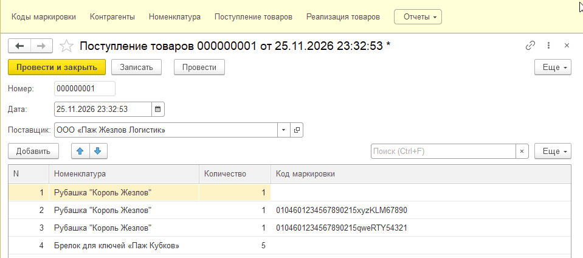
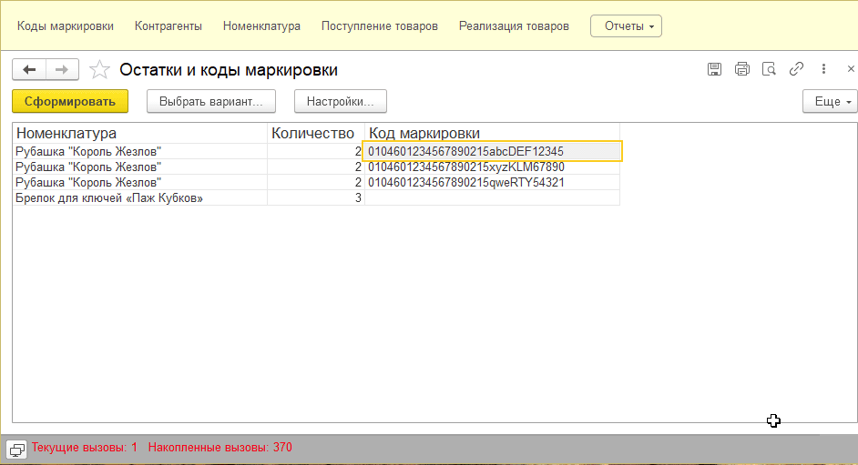

# 📦 Учет маркированного товара и склада (1С:Предприятие 8.3)


Учебная конфигурация, разработанная с нуля на платформе **«1С:Предприятие 8.3»** (тонкий клиент, интерфейс «Такси»). Проект моделирует контур складского учёта и работу с кодами маркировки **GS1 DataMatrix (ИС МП «Честный знак»)** по аналогии с подсистемой из типовой «1С:Управление торговлей 11».

🎯 **Цель проекта:** демонстрация навыков проектирования архитектуры данных, написания оптимальных запросов к виртуальным таблицам, работы с регистрами и транзакционной обработки бизнес-исключений на уровне кода.

---

### 🏗 Архитектура и состав конфигурации

* **Справочники (НСИ):**
  * `Номенклатура` — хранение товаров с признаком обязательной маркировки (`МаркируемыйТовар`, Булево) и артикулом.
  * `Контрагенты` — поставщики и покупатели с хранением реквизитов (`ИНН`).
* **Регистры:**
  * `ОстаткиТоваров` *(Регистр накопления, вид: Остатки)* — количественный складской учёт в разрезе номенклатуры.
  * `КодыМаркировки` *(Независимый регистр сведений)* — пул активных кодов DataMatrix на балансе организации (`КодМаркировки`, `Номенклатура`, `ВНаличии`).
* **Документы и отчёты:**
  * `ПоступлениеТоваров` — приёмка товара на склад и постановка кодов маркировки на баланс.
  * `РеализацияТоваров` — пакетный контроль остатков, отгрузка и вывод кодов DataMatrix из оборота.
  * `ОстаткиИКодыМаркировки` *(Отчёт на СКД)* — сверка актуальных складских остатков с пулом активных марок.

---

### ⚙️ Реализованная бизнес-логика (BSL)

#### 1. Приёмка товара (`src/Documents/ПоступлениеТоваров.bsl`)
* **Валидация при проведении:** транзакционная блокировка (`Отказ = Истина`) при попытке провести маркируемый товар без отсканированного кода DataMatrix.
* **Контроль уникальности:** запись кодов в независимый регистр сведений через `МенеджерЗаписи` обеспечивает защиту от дублирования марок на уровне первичного ключа.
* **Движения:** формирование прихода в регистр накопления `ОстаткиТоваров`.

#### 2. Отгрузка и вывод из оборота (`src/Documents/РеализацияТоваров.bsl`)
* **Защита от отрицательных остатков:** пакетный запрос к виртуальной таблице `ОстаткиТоваров.Остатки(&МоментВремени, ...)` с использованием `Граница(МоментВремени(), ВидГраницы.Исключая)` — корректно отрабатывает даже при проведении документов «задним числом» и исключает проблему запроса в цикле.
* **Контроль и списание марок:** проверка наличия кода DataMatrix на балансе через `НаборЗаписей` и удаление кода из пула активных марок при продаже.

#### 3. Аналитическая отчётность (`src/Reports/ОстаткиИКодыМаркировки.sql`)
* Построен на базе **СКД (Системы компоновки данных)**.
* Использует `ЛЕВОЕ СОЕДИНЕНИЕ` между виртуальной таблицей остатков и регистром сведений `КодыМаркировки` для одновременного отображения общего остатка и конкретных кодов в разрезе позиций.

---

### 🎥 Демонстрация работы

#### 1. Контроль приёмки «Честного знака»
Попытка провести маркируемый товар без кода DataMatrix блокирует транзакцию, после сканирования/ввода кода накладная успешно проводится:



#### 2. Защита от ухода остатков в минус и вывод марки из оборота
При попытке отгрузить больше товара, чем числится на складе, система выводит уведомление о нехватке остатка; после корректировки количества товар списывается, а код маркировки выводится из пула активных марок:


#### 3. Аналитический отчёт на СКД и журнал пула кодов маркировки
Формирование отчёта по текущим складским остаткам с привязанными кодами DataMatrix и проверка актуального пула активных марок на балансе:



---

### 📂 Структура репозитория

```text
├── README.md                                   # Документация проекта и демонстрация работы
├── media/                                      # GIF-анимации основных сценариев
│   ├── 01_receipt_check.gif                    # Валидация кода DataMatrix при поступлении
│   ├── 02_sales_control.gif                    # Проверка остатков и списание марки при реализации
│   └── 03_skd_report.gif                       # Формирование отчёта на СКД
├── release/
│   └── UchetMarkirovki.cf                      # Выгрузка конфигурации 1С:Предприятие 8.3
└── src/
    ├── Documents/
    │   ├── ПоступлениеТоваров.bsl              # Модуль объекта документа поступления
    │   └── РеализацияТоваров.bsl               # Модуль объекта документа реализации
    └── Reports/
        └── ОстаткиИКодыМаркировки.sql          # Текст запроса для СКД
```

---

### 🚀 Как развернуть проект локально

1. Скачайте файл выгрузки конфигурации из папки **`release/`** (`UchetMarkirovki.cf`).
2. Создайте новую пустую информационную базу в **«1С:Предприятие 8.3»** (подойдёт учебная версия платформы).
3. Откройте базу в режиме **Конфигуратор** → *Конфигурация* → *Загрузить конфигурацию из файла* → выберите скачанный `.cf`.
4. Примите изменения структуры БД (`F7`) и запустите режим **1С:Предприятие**.
